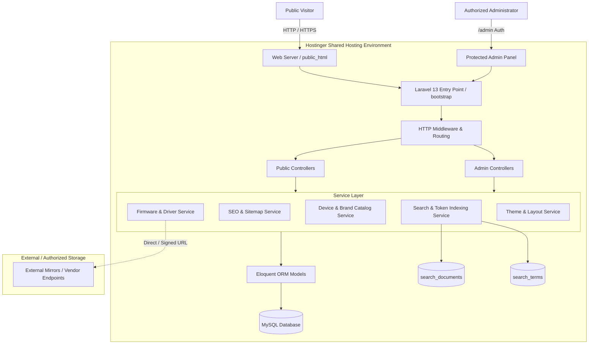

# Mobile Resource Hub — Architecture Specification

## 1. System Overview
Mobile Resource Hub is a high-performance, search-centric mobile specification and software portal built on Laravel 13, Blade, Bootstrap 5.3, and MySQL, engineered specifically to operate reliably on Hostinger Shared Hosting (current Unlimited / Business-equivalent tier).



## 2. Technology Stack & Runtime Compatibility
- **Framework:** Laravel 13
- **PHP Compatibility:** PHP 8.3 (local minimum & baseline) to PHP 8.5 (Hostinger target)
- **Database:** MySQL 8.0+ (Shared Hosting compatible) / SQLite (fast local automated testing)
- **Frontend & Assets:** Laravel Blade, Bootstrap 5.3.x, Bootstrap Icons, Vanilla JavaScript, Vite asset bundler
- **Search Engine:** Database-driven full-site search engine with application-maintained token index (`search_documents` and `search_terms`) guaranteeing zero stop-word omissions and instant freshness without external daemons (no Elasticsearch, Meilisearch, or Redis required)
- **Queue/Jobs:** Synchronous indexing for immediate search freshness during publishing workflows; scheduled fallback reconciliation via standard Cron

## 3. Directory Structure
```
mobile-resource-hub/
├── app/
│   ├── Http/
│   │   ├── Controllers/
│   │   │   ├── Public/             # Public browsing, search, contact controllers
│   │   │   └── Admin/              # Protected administration controllers
│   │   └── Middleware/             # Role authorization, rate limiting, theme tokens
│   ├── Models/                     # Eloquent models with strict typing & casts
│   ├── Services/
│   │   ├── Search/                 # Search documents and token tokenizer service
│   │   ├── Seo/                    # Metadata generator, canonical URLs, sitemaps
│   │   ├── Catalog/                # Brands, devices, dynamic spec managers
│   │   ├── Publishing/             # Editorial workflow & revision lifecycle
│   │   └── Theme/                  # Theme tokens and layout settings compiler
│   └── Policies/                   # Granular authorization policies
├── database/
│   ├── migrations/                 # Fully normalized schema migrations
│   └── seeders/                    # Deterministic, non-fabricated demo seeders
├── resources/
│   ├── views/
│   │   ├── layouts/
│   │   │   ├── public.blade.php    # Glassmorphism header, responsive footer, theme boot
│   │   │   └── admin.blade.php     # Admin dashboard and module layouts
│   │   ├── components/             # Reusable Blade UI components (cards, search, badges)
│   │   ├── public/                 # Public views for devices, firmware, news, etc.
│   │   └── admin/                  # Administrative CRUD modules
│   ├── css/                        # CSS tokens, glassmorphism styles, dark mode
│   └── js/                         # Vanilla JS search autocompletion, theme switcher
├── routes/
│   ├── web.php                     # Public routes & search endpoints
│   └── admin.php                   # Protected administrative routes
├── docs/                           # Architecture, DB, security, and PRD specifications
└── tests/                          # Automated feature & unit test suite
```

## 4. Public vs. Private Deployment Topology
To ensure zero exposure of `.env`, `vendor`, `storage`, and internal code on shared hosting:
- Private application files are placed in an isolated directory outside the web root (e.g. `/home/uXXXX/mobile-resource-hub-app`).
- Only the compiled assets and public entry script reside in the publicly exposed document root (`/home/uXXXX/domains/example.com/public_html`).
- The entry `index.php` loads the private bootstrap securely.

## 5. Mobile Brands & Dynamic Specifications System (Phase 3)
The device catalog is decoupled from rigid column structures using a relational Dynamic Specifications design:
- `brands`: Hardware manufacturers with slug routing, logo storage, and delete guards.
- `devices`: Core mobile entities with independent website publication status (`status`) vs. commercial market availability (`market_status`).
- `device_model_numbers`: Regional and carrier variants mapped 1:N to devices.
- `device_variants`: Hardware SKUs with RAM, internal storage, color, and price annotations.
- `specification_groups` & `specification_fields`: Dynamic EAV configuration allowing administrators to introduce technical parameters without database migrations.
- `device_specification_values`: Relational values linked to fields and devices, retrieved via `getGroupedSpecifications()`.

## 6. Firmware, Flash Files, and Download Architecture (Phase 4)
Phase 4 introduces a complete file distribution and mirror management layer:
- **`FileStorageService`**: Storage abstraction for private disk operations outside the web root, chunked streaming responses (64 KB chunks), streamed cryptographic hashing (MD5 & SHA-256), and safe URL validation.
- **Polymorphic Download Mirrors**: The `DownloadMirror` model binds to any downloadable resource (`Firmware`, `FlashFile`, `SoftwareTool`, `Driver`), providing multiple CDN mirrors, official vendor links, or local server private downloads.
- **Download Gateway (`/downloads/mirror/{mirror}`)**: Rate-limited endpoint (`throttle:60,1`) that validates resource publication status, records audit metadata into `download_requests`, increments metric counters, and streams local files or securely redirects to verified external mirrors.
- **Threat Mitigation**: Enforces open-redirect prevention, rejects SSRF targets (localhost and RFC1918 private subnets), and enforces an extension allowlist preventing execution of uploaded payloads.
- **Search Hooks:** Domain events (`BrandSaved`, `BrandDeleted`, `DeviceSaved`, `DeviceDeleted`) dispatch to `SearchIndexingHook` to maintain search index currency.

## 7. Global Search Engine & SEO Automation Architecture (Phase 5)
- **Token Index Engine (`SearchIndexingService`):** Maintains normalized search documents and term index (`search_documents`, `search_document_terms`) directly in MySQL. Automatically indexes devices, firmware, flash files, software, drivers, posts, and pages on lifecycle events (`created`, `updated`, `deleted`).
- **Synchronous Lifecycle Currency:** Changes to searchable content instantly reflect in search results; unpublished content is immediately purged from search queries and sitemaps.
- **Dynamic XML Sitemaps (`SitemapService`):** Generates `sitemap.xml` index linking to 6 sub-sitemaps with `<lastmod>`, `<changefreq>`, and `<priority>`. Dynamically updates `public/robots.txt`.

## 8. Theme Customizer, Homepage & Advertisement Architecture (Phase 6)
- **Theme Customizer (`ThemeService`):** Split-screen admin design studio with live public preview iframe. Draft/published state separation, snapshot versioning (`theme_versions`), one-click rollback, and safe CSS variable compilation cached permanently via `Cache::rememberForever()`.
- **Homepage Section Manager (`HomepageService`):** Manages 11 catalog sections with real-time visibility toggles, drag-and-drop reordering, custom presentation titles/subtitles, and eager-loaded Eloquent model hydration.
- **Advertisement Delivery & Analytics (`AdvertisementService`):** 17 standardized layout placement slots with date-based scheduling, device/theme targeting, weighted random rotation, click tracking with open redirect prevention, Super Admin privileged custom HTML snippet execution, and genuine CTR analytics without number fabrication.
