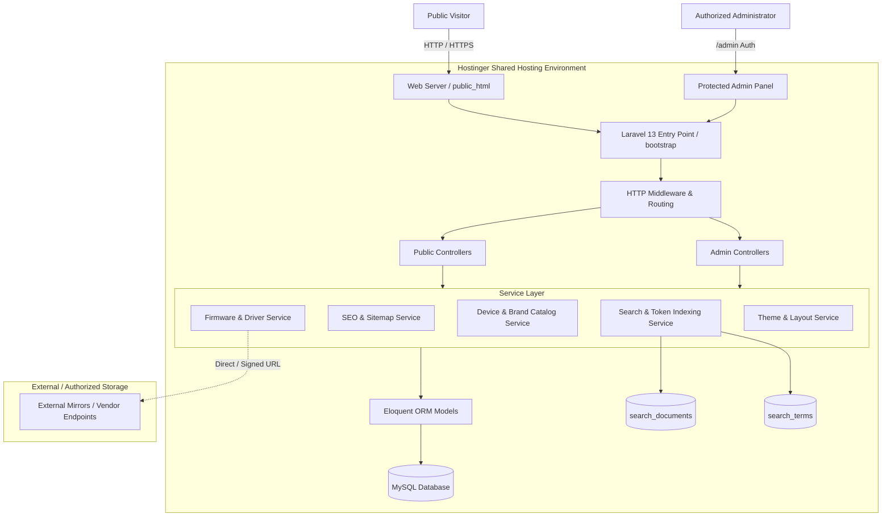

# Mobile Resource Hub — Architecture Specification

## 1. System Overview
Mobile Resource Hub is a high-performance, search-centric mobile specification and software portal built on Laravel 13, Blade, Bootstrap 5.3, and MySQL, engineered specifically to operate reliably on Hostinger Shared Hosting (current Unlimited / Business-equivalent tier).



## 2. Technology Stack & Runtime Compatibility
- **Framework:** Laravel 13
- **PHP Compatibility:** PHP 8.3 (local minimum & baseline) to PHP 8.5 (Hostinger target)
- **Database:** MySQL 8.0+ (Shared Hosting compatible) / SQLite (fast local automated testing)
- **Frontend & Assets:** Laravel Blade, Bootstrap 5.3.x, Bootstrap Icons, Vanilla JavaScript, Vite asset bundler
- **Search Engine:** Database-driven full-site search engine with application-maintained token index (`search_documents` and `search_terms`) guaranteeing zero stop-word omissions and instant freshness without external daemons (no Elasticsearch, Meilisearch, or Redis required)
- **Queue/Jobs:** Synchronous indexing for immediate search freshness during publishing workflows; scheduled fallback reconciliation via standard Cron

## 3. Directory Structure
```
mobile-resource-hub/
├── app/
│   ├── Http/
│   │   ├── Controllers/
│   │   │   ├── Public/             # Public browsing, search, contact controllers
│   │   │   └── Admin/              # Protected administration controllers
│   │   └── Middleware/             # Role authorization, rate limiting, theme tokens
│   ├── Models/                     # Eloquent models with strict typing & casts
│   ├── Services/
│   │   ├── Search/                 # Search documents and token tokenizer service
│   │   ├── Seo/                    # Metadata generator, canonical URLs, sitemaps
│   │   ├── Catalog/                # Brands, devices, dynamic spec managers
│   │   ├── Publishing/             # Editorial workflow & revision lifecycle
│   │   └── Theme/                  # Theme tokens and layout settings compiler
│   └── Policies/                   # Granular authorization policies
├── database/
│   ├── migrations/                 # Fully normalized schema migrations
│   └── seeders/                    # Deterministic, non-fabricated demo seeders
├── resources/
│   ├── views/
│   │   ├── layouts/
│   │   │   ├── public.blade.php    # Glassmorphism header, responsive footer, theme boot
│   │   │   └── admin.blade.php     # Admin dashboard and module layouts
│   │   ├── components/             # Reusable Blade UI components (cards, search, badges)
│   │   ├── public/                 # Public views for devices, firmware, news, etc.
│   │   └── admin/                  # Administrative CRUD modules
│   ├── css/                        # CSS tokens, glassmorphism styles, dark mode
│   └── js/                         # Vanilla JS search autocompletion, theme switcher
├── routes/
│   ├── web.php                     # Public routes & search endpoints
│   └── admin.php                   # Protected administrative routes
├── docs/                           # Architecture, DB, security, and PRD specifications
└── tests/                          # Automated feature & unit test suite
```

## 4. Public vs. Private Deployment Topology
To ensure zero exposure of `.env`, `vendor`, `storage`, and internal code on shared hosting:
- Private application files are placed in an isolated directory outside the web root (e.g. `/home/uXXXX/mobile-resource-hub-app`).
- Only the compiled assets and public entry script reside in the publicly exposed document root (`/home/uXXXX/domains/example.com/public_html`).
- The entry `index.php` loads the private bootstrap securely.
