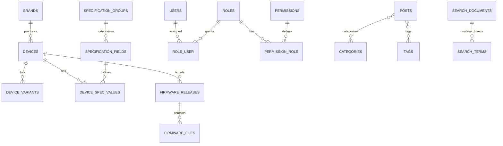

# Mobile Resource Hub — Database Specification

## 1. Schema Design Philosophy
The database is designed with strict relational integrity, indexed foreign keys, optimized compound indexes for filter/sorting combinations, and dedicated search and token tables to eliminate external search dependencies while maintaining sub-millisecond query execution.

## 2. Entity Relationship Overview

## 3. Core Tables

### 3.1 Authentication & Privileged Access
- `users`: ID, name, email, password, remember_token, timestamps.
- `roles`: ID, name (slug: `super-admin`, `admin`, `editor`, `device-manager`, `firmware-manager`, `seo-manager`, `ads-manager`), display_name, description.
- `permissions`: ID, name, display_name, module.
- `role_user`: user_id, role_id.
- `permission_role`: role_id, permission_id.
- `activity_logs`: ID, user_id, action, subject_type, subject_id, properties (JSON), ip_address, created_at.

### 3.2 Mobile Device Catalog
- `brands`: ID, name, slug (unique index), logo, description, website, status (`published`, `draft`, `archived`), timestamps.
- `devices`: ID, brand_id, name, slug (unique index), model_family, release_date, announced_date, status (`published`, `draft`, `archived`), hero_image, highlights (JSON), created_at, updated_at.
- `device_variants`: ID, device_id, name, market_region, model_code, ram_storage, notes.
- `specification_groups`: ID, name, slug, sort_order, is_visible.
- `specification_fields`: ID, group_id, name, key (unique index), unit, data_type (`text`, `number`, `boolean`, `select`), sort_order, is_filterable, is_searchable.
- `device_spec_values`: ID, device_id, variant_id (nullable), field_id, value, source, verification_status (`verified`, `manufacturer_claim`, `unconfirmed`).

### 3.3 Firmware, Software, and Drivers
- `firmware_releases`: ID, device_id, title, slug (unique index), model_code, region_code, android_version, ui_version, build_number, security_patch_date, release_date, instructions, status, distribution_rights (`official_link_only`, `authorized_mirror`, `site_hosted`).
- `firmware_files`: ID, firmware_release_id, file_name, file_type, file_size_bytes, md5_checksum, sha256_checksum, download_url, mirror_type (`official`, `mirror`, `storage`), is_active.
- `software_tools`: ID, name, slug, publisher, category, license_type, description, official_url, status.
- `software_versions`: ID, software_tool_id, version, release_date, supported_os, file_name, file_size_bytes, download_url, checksum, status.
- `drivers`: ID, name, slug, version, supported_os, supported_devices, official_url, download_url, checksum, status.

### 3.4 Editorial Content
- `categories`: ID, name, slug, parent_id, description, timestamps.
- `tags`: ID, name, slug, timestamps.
- `posts`: ID, author_id, type (`news`, `tutorial`, `guide`, `article`), title, slug, excerpt, body, featured_image, status (`draft`, `in_review`, `scheduled`, `published`, `archived`), published_at, timestamps.
- `category_post`: category_id, post_id.
- `post_tag`: post_id, tag_id.
- `pages`: ID, title, slug, body, is_system (`about`, `contact`, `privacy`, `terms`, `dmca`), status, timestamps.

### 3.5 Global Search Engine Tables
- `search_documents`:
  - `id` (bigint unsigned auto_increment)
  - `documentable_type` (varchar(191))
  - `documentable_id` (bigint unsigned)
  - `title` (varchar(255))
  - `slug` (varchar(255))
  - `canonical_url` (varchar(255))
  - `content_type` (enum: `device`, `firmware`, `software`, `driver`, `post`, `page`)
  - `excerpt` (text)
  - `searchable_body` (mediumtext)
  - `model_code` (varchar(100), nullable, indexed)
  - `is_published` (boolean, indexed)
  - `published_at` (datetime)
  - Compound indexes: `(is_published, content_type)`, `(model_code)`
- `search_terms`:
  - `id` (bigint unsigned auto_increment)
  - `search_document_id` (foreign key to `search_documents`, onDelete cascade)
  - `term` (varchar(100), indexed)
  - `weight` (int unsigned)
  - Compound index: `(term, search_document_id)`
- `search_logs`:
  - `id` (bigint unsigned auto_increment)
  - `query` (varchar(255))
  - `results_count` (int unsigned)
  - `created_at` (timestamp)

### 3.6 Settings, Navigation, Ads, and Analytics
- `site_settings`: key, value (JSON/text).
- `theme_settings`: key, value.
- `menus` & `menu_items`: navigation structures.
- `ad_slots`: placement key, title, code_snippet, is_enabled.
- `download_events`: resource_type, resource_id, mirror_id, ip_hash (privacy-safe SHA256 snippet), user_agent, created_at.
- `contact_messages`: name, email, subject, message, status (`unread`, `read`, `replied`, `archived`), ip_hash, created_at.
