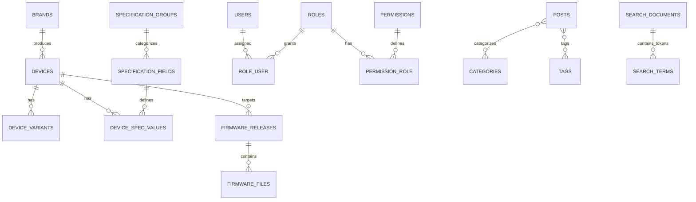

# Mobile Resource Hub — Database Specification

## 1. Schema Design Philosophy
The database is designed with strict relational integrity, indexed foreign keys, optimized compound indexes for filter/sorting combinations, and dedicated search and token tables to eliminate external search dependencies while maintaining sub-millisecond query execution.

## 2. Entity Relationship Overview

## 3. Core Tables

### 3.1 Authentication & Privileged Access
- `users`: ID, name, email, password, remember_token, timestamps.
- `roles`: ID, name (slug: `super-admin`, `admin`, `editor`, `device-manager`, `firmware-manager`, `seo-manager`, `ads-manager`), display_name, description.
- `permissions`: ID, name, display_name, module.
- `role_user`: user_id, role_id.
- `permission_role`: role_id, permission_id.
- `activity_logs`: ID, user_id, action, subject_type, subject_id, properties (JSON), ip_address, created_at.

### 3.2 Mobile Device Catalog
- `brands`: ID, name, slug (unique index), logo, description, website, status (`published`, `draft`, `archived`), timestamps.
- `devices`: ID, brand_id, name, slug (unique index), model_family, release_date, announced_date, status (`published`, `draft`, `archived`), hero_image, highlights (JSON), created_at, updated_at.
- `device_variants`: ID, device_id, name, market_region, model_code, ram_storage, notes.
- `specification_groups`: ID, name, slug, sort_order, is_visible.
- `specification_fields`: ID, group_id, name, key (unique index), unit, data_type (`text`, `number`, `boolean`, `select`), sort_order, is_filterable, is_searchable.
- `device_spec_values`: ID, device_id, variant_id (nullable), field_id, value, source, verification_status (`verified`, `manufacturer_claim`, `unconfirmed`).

### 3.3 Firmware, Flash Files, Software, and Drivers (Phase 4 Production Schema)
- `firmwares`:
  - `id` (bigint unsigned auto_increment)
  - `brand_id` (foreign key to `brands`, restrictOnDelete)
  - `device_id` (nullable foreign key to `devices`, nullOnDelete)
  - `title` (varchar(255))
  - `slug` (varchar(191) unique index)
  - `model_number` (varchar(100) indexed)
  - `compatible_models` (json nullable)
  - `region` (varchar(100) nullable)
  - `csc` (varchar(50) nullable indexed)
  - `android_version` (varchar(50) nullable)
  - `os_version` (varchar(100) nullable)
  - `firmware_version` (varchar(100) nullable)
  - `build_number` (varchar(100) nullable indexed)
  - `security_patch_date` (date nullable)
  - `release_date` (date nullable indexed)
  - `file_type` (varchar(100) default 'Stock ROM')
  - `archive_format` (varchar(50) default 'zip')
  - `file_size_bytes` (bigint unsigned nullable)
  - `file_size_formatted` (varchar(50) nullable)
  - `md5_checksum` (varchar(64) nullable)
  - `sha256_checksum` (varchar(64) nullable)
  - `flashing_instructions`, `required_tools`, `prerequisites`, `warnings`, `known_issues` (text nullable)
  - `source_website`, `official_download_url` (varchar nullable)
  - `license_type` (varchar(100))
  - `distribution_permission` (enum/varchar: `official_link_only`, `authorized_mirror`, `site_hosted`)
  - `is_verified` (boolean default true)
  - `status` (varchar(30) default 'draft' indexed)
  - `download_requests_count` (bigint unsigned default 0)
  - `seo_title`, `meta_description`, `canonical_url`, `og_image`
  - `deleted_at`, `timestamps`
- `download_mirrors` (polymorphic across `Firmware`, `FlashFile`, `SoftwareTool`, `Driver`):
  - `id` (bigint unsigned auto_increment)
  - `mirrorable_type` (varchar(191)), `mirrorable_id` (bigint unsigned) — compound indexed
  - `mirror_name` (varchar(100))
  - `url` (varchar(1000) nullable)
  - `disk` (varchar(50) default 'local')
  - `file_path` (varchar(500) nullable)
  - `file_size_bytes` (bigint unsigned nullable)
  - `is_local` (boolean default false)
  - `is_official` (boolean default false)
  - `is_active` (boolean default true)
  - `download_requests_count` (bigint unsigned default 0)
  - `sort_order` (int default 0)
  - `timestamps`
- `download_requests`:
  - `id` (bigint unsigned auto_increment)
  - `downloadable_type` (varchar(191)), `downloadable_id` (bigint unsigned) — compound indexed
  - `mirror_id` (foreign key to `download_mirrors`, cascadeOnDelete)
  - `ip_address` (varchar(45) nullable)
  - `user_agent` (varchar(500) nullable)
  - `status` (varchar(50) default 'redirected')
  - `created_at` (timestamp)
- `flash_files`:
  - `id` (bigint unsigned auto_increment)
  - `brand_id` (foreign key to `brands`, restrictOnDelete)
  - `device_id` (nullable foreign key to `devices`, nullOnDelete)
  - `title`, `slug` (unique), `model_number`
  - `chipset` (varchar(100) nullable)
  - `file_type` (`stock_rom`, `scatter_firmware`, `pac_file`, `qfil_package`, `da_file`, `recovery_image`, `boot_image`)
  - `android_version`, `file_size_bytes`, `file_size_formatted`, `md5_checksum`, `sha256_checksum`
  - `flashing_tool`, `compatibility_notes`, `installation_instructions`
  - `source_website`, `official_download_url`, `distribution_permission`
  - `is_verified`, `status`, `download_requests_count`
  - `seo_title`, `meta_description`, `canonical_url`, `og_image`, `deleted_at`, `timestamps`
- `software_tools`:
  - `id` (bigint unsigned auto_increment)
  - `name`, `slug` (unique)
  - `category` (`flashing_tools`, `android_utilities`, `mobile_repair_tools`, `backup_tools`, `recovery_utilities`, `device_management`)
  - `version`, `developer`, `supported_os`, `supported_architectures`
  - `description`, `changelog`, `release_date`, `file_format`, `file_size_bytes`, `file_size_formatted`
  - `md5_checksum`, `sha256_checksum`, `license_type`, `distribution_permission`, `official_website`
  - `dependencies`, `installation_instructions`, `is_verified`, `status`, `download_requests_count`
  - `seo_title`, `meta_description`, `canonical_url`, `og_image`, `deleted_at`, `timestamps`
- `drivers`:
  - `id` (bigint unsigned auto_increment)
  - `brand_id` (nullable foreign key to `brands`, nullOnDelete)
  - `name`, `slug` (unique), `driver_version`, `os`, `windows_versions`, `architecture`
  - `release_date`, `supported_devices`, `file_type`, `file_size_bytes`, `file_size_formatted`
  - `md5_checksum`, `sha256_checksum`, `official_source`, `distribution_permission`, `installation_instructions`
  - `is_verified`, `status`, `download_requests_count`
  - `seo_title`, `meta_description`, `canonical_url`, `og_image`, `deleted_at`, `timestamps`

### 3.4 Editorial Content
- `categories`: ID, name, slug, parent_id, description, timestamps.
- `tags`: ID, name, slug, timestamps.
- `posts`: ID, author_id, type (`news`, `tutorial`, `guide`, `article`), title, slug, excerpt, body, featured_image, status (`draft`, `in_review`, `scheduled`, `published`, `archived`), published_at, timestamps.
- `category_post`: category_id, post_id.
- `post_tag`: post_id, tag_id.
- `pages`: ID, title, slug, body, is_system (`about`, `contact`, `privacy`, `terms`, `dmca`), status, timestamps.

### 3.5 Global Search Engine Tables
- `search_documents`:
  - `id` (bigint unsigned auto_increment)
  - `documentable_type` (varchar(191))
  - `documentable_id` (bigint unsigned)
  - `title` (varchar(255))
  - `slug` (varchar(255))
  - `canonical_url` (varchar(255))
  - `content_type` (enum: `device`, `firmware`, `software`, `driver`, `post`, `page`)
  - `excerpt` (text)
  - `searchable_body` (mediumtext)
  - `model_code` (varchar(100), nullable, indexed)
  - `is_published` (boolean, indexed)
  - `published_at` (datetime)
  - Compound indexes: `(is_published, content_type)`, `(model_code)`
- `search_terms`:
  - `id` (bigint unsigned auto_increment)
  - `search_document_id` (foreign key to `search_documents`, onDelete cascade)
  - `term` (varchar(100), indexed)
  - `weight` (int unsigned)
  - Compound index: `(term, search_document_id)`
- `search_logs`:
  - `id` (bigint unsigned auto_increment)
  - `query` (varchar(255))
  - `results_count` (int unsigned)
  - `created_at` (timestamp)

### 3.6 Settings, Navigation, Ads, and Analytics (Legacy Baseline)
- `site_settings`: key, value (JSON/text).
- `menus` & `menu_items`: navigation structures.
- `contact_messages`: name, email, subject, message, status (`unread`, `read`, `replied`, `archived`), ip_hash, created_at.

### 3.7 Phase 6: Theme Customization, Homepage & Monetization Schema
- `themes`:
  - `id` (bigint unsigned auto_increment primary key)
  - `name` (varchar(100)), `slug` (varchar(100) unique)
  - `is_active` (boolean indexed), `version` (unsigned int default 1)
  - `created_by`, `updated_by` (foreign keys to `users`, nullOnDelete)
  - `timestamps`
- `theme_settings`:
  - `id` (bigint unsigned auto_increment primary key)
  - `theme_id` (foreign key to `themes`, cascadeOnDelete)
  - `is_published` (boolean indexed; false = working draft, true = active published)
  - `branding`, `global_colors`, `light_palette`, `dark_palette`, `typography`, `layout`, `glassmorphism`, `buttons`, `animations` (json nullable)
  - Unique compound index: `(theme_id, is_published)`
  - `timestamps`
- `theme_versions`:
  - `id` (bigint unsigned auto_increment primary key)
  - `theme_id` (foreign key to `themes`, cascadeOnDelete)
  - `version_number` (unsigned int)
  - `settings_snapshot` (json)
  - `change_summary` (varchar(255) nullable)
  - `published_by` (foreign key to `users`, nullOnDelete)
  - `published_at` (timestamp nullable)
  - Compound index: `(theme_id, version_number)`
  - `timestamps`
- `homepage_sections`:
  - `id` (bigint unsigned auto_increment primary key)
  - `section_key` (varchar(50) unique index)
  - `title` (varchar(255)), `subtitle` (varchar(255) nullable)
  - `is_enabled` (boolean indexed default true)
  - `sort_order` (int indexed default 0)
  - `item_count` (int default 8)
  - `display_style` (varchar(50) default 'grid')
  - `background_style` (varchar(50) default 'default')
  - `category_filter` (varchar(100) nullable)
  - `settings` (json nullable)
  - `timestamps`
- `advertisements`:
  - `id` (bigint unsigned auto_increment primary key)
  - `name` (varchar(150)), `placement` (varchar(50) indexed)
  - `type` (varchar(30) default 'image'; `image`, `url`, `network`, `custom_html`)
  - `image_path` (varchar(255) nullable), `image_alt` (varchar(255) nullable)
  - `destination_url` (varchar(500) nullable), `custom_html` (text nullable)
  - `campaign_name` (varchar(100) nullable)
  - `start_date` (datetime nullable), `end_date` (datetime nullable)
  - `priority` (int default 1), `rotation_weight` (int default 10)
  - `show_desktop`, `show_tablet`, `show_mobile` (boolean default true)
  - `show_light_theme`, `show_dark_theme` (boolean default true)
  - `is_active` (boolean indexed default true)
  - `impressions_count` (bigint unsigned default 0)
  - `clicks_count` (bigint unsigned default 0)
  - `created_by`, `updated_by` (foreign keys to `users`, nullOnDelete)
  - Compound index: `(placement, is_active)`
  - `timestamps`
- `advertisement_logs`:
  - `id` (bigint unsigned auto_increment primary key)
  - `advertisement_id` (foreign key to `advertisements`, cascadeOnDelete)
  - `event_type` (varchar(20); `impression`, `click`)
  - `placement` (varchar(50))
  - `device_category` (varchar(20) default 'desktop')
  - `theme_mode` (varchar(20) default 'light')
  - `session_hash` (varchar(64) nullable)
  - `created_at` (timestamp indexed nullable)
  - Compound index: `(advertisement_id, event_type)`
