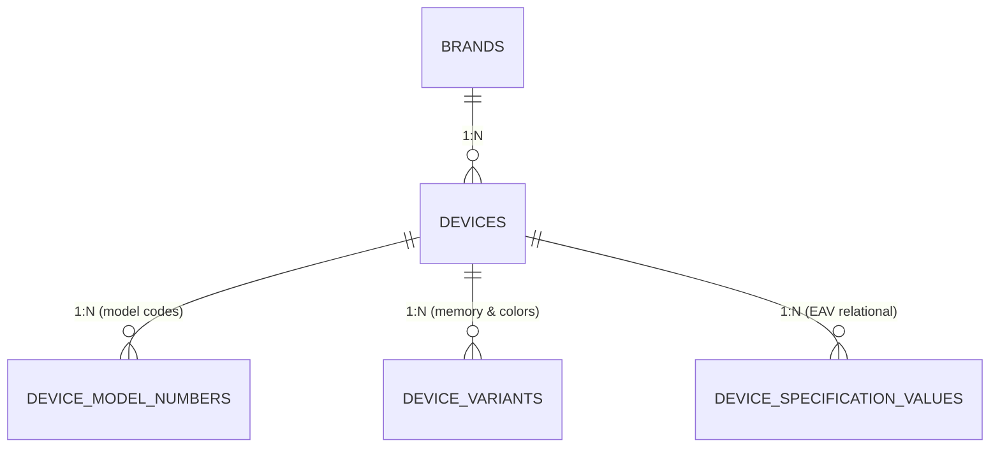

# Mobile Device & Catalog Management — Mobile Resource Hub

## 1. Overview
The **Mobile Device Management** module is the central engine of Mobile Resource Hub, accessible at `/admin/devices`. It enables administrators to manage hardware identity, model designations, hardware memory/color variants, and technical specifications across all mobile form factors.

## 2. Decoupled Status Architecture

### 2.1 Publication Status vs. Commercial Market Status
A critical architectural requirement strictly enforced in Phase 3 is the complete separation of website publication status from commercial availability:
- **Publication Status (`status`):** `draft`, `published`, `archived`. Controls visibility to public visitors on the website.
- **Commercial Market Status (`market_status`):** `upcoming`, `available`, `discontinued`. Represents the commercial product availability in retail markets.

*Examples of valid combinations:*
- `status: published` + `market_status: upcoming`: An unreleased or rumored device whose specifications are verified and published for reader awareness.
- `status: published` + `market_status: discontinued`: A legacy smartphone kept live for firmware downloads, driver archives, and repair guides.
- `status: draft` + `market_status: available`: A new device whose full spec sheet is currently being drafted by editors before public launch.

## 3. Data Model & Relationships

### 3.1 Model Numbers (`device_model_numbers`)
Smartphones are distributed globally with distinct regional codes. The system allows an arbitrary number of model numbers per device:
- `model_number`: e.g. `SM-S928B`, `SM-S928U`, `A3296`.
- `region`: Global, North America, Europe, Asia-Pacific, Carrier Locked.
- `is_primary`: Flag denoting the primary reference code.

### 3.2 Hardware Variants (`device_variants`)
Enables tracking of specific SKU and retail configurations:
- `name`: Configuration title (e.g. `256GB / 12GB RAM`).
- `ram`: RAM capacity (e.g. `12GB LPDDR5X`).
- `internal_storage`: ROM capacity (e.g. `256GB UFS 4.0`).
- `color`: Finish name (e.g. `Titanium Gray`).
- `notes`: Launch price, carrier notes, or SKU code.

### 3.3 Dynamic Specification Sheet Synchronization
When saving or updating a device record:
- The controller wraps the write in a database transaction (`DB::transaction`).
- Model numbers and hardware variants are synchronized cleanly.
- Dynamic specification values (`specs[field_id]`) are updated or cleared.
- Domain events (`DeviceSaved` or `DeviceDeleted`) are fired to maintain search index consistency.

## 4. Media & Gallery Architecture
- **Featured Image:** Primary transparent PNG/WEBP cutout shown on catalog cards and specification banners.
- **Image Gallery:** Multi-image JSON column storing lifestyle images, chassis renders, and color comparisons.
- **Reference-Aware Media Deletion:** `MediaController` actively verifies that an image is not referenced in `featured_image` or `image_gallery` before permitting physical file deletion.
