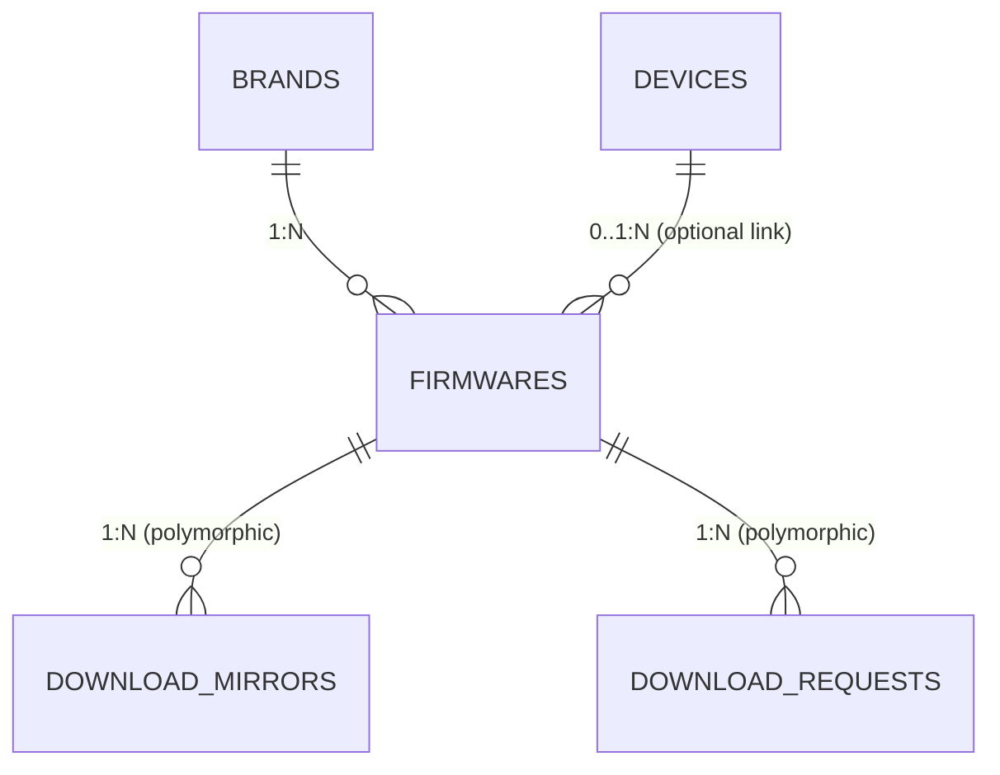

# Firmware Management — Mobile Resource Hub

## 1. Overview
The **Firmware Management** module (`/admin/firmware`) handles official stock ROM releases, operating system upgrades, security patches, and emergency repair packages for smartphones and mobile devices.

## 2. Technical Architecture & Data Model

### 2.1 Identification & Regional Metadata
- **`title`**: Clear descriptive package title (e.g., `Samsung Galaxy S24 Ultra Android 15 OneUI 7.0 (SM-S928B)`).
- **`slug`**: URL slug unique across firmwares.
- **`brand_id`**: Foreign key to `brands`.
- **`device_id`**: Optional foreign key to `devices` catalog.
- **`model_number`**: Hardware model code (e.g. `SM-S928B`, `2312DRA50G`).
- **`compatible_models`**: JSON array of cross-compatible hardware sub-variants.
- **`region`**: Geographic market (e.g., `Europe`, `Global`, `North America`).
- **`csc`**: Carrier Sales Code / Product Code (e.g., `OXM`, `EUX`, `INS`, `TMB`).

### 2.2 Version & Technical Specification Fields
- **`android_version`**: Base Android OS version (e.g., `Android 15`).
- **`os_version`**: Proprietary UI skin (e.g., `One UI 7.0`, `HyperOS 2.0`).
- **`firmware_version`**: Internal release string.
- **`build_number`**: PDA / Build fingerprint (e.g., `S928BXXU3BXK2`).
- **`security_patch_date`**: Android SPL date (e.g., `2026-11-01`).
- **`release_date`**: Official manufacturer rollout date.
- **`file_type`**: Package architecture (`Stock ROM`, `Fastboot ROM`, `Recovery ROM`, `Scatter ROM`, `EDL Fastboot`, `Combination ROM`).
- **`archive_format`**: Compressed extension (`.zip`, `.tar.md5`, `.tgz`, `.7z`, `.rar`).
- **`file_size_bytes`**: Exact unsigned 64-bit integer size for byte-level accuracy.
- **`file_size_formatted`**: Display size (e.g., `9.24 GB`).
- **`md5_checksum`**: 32-character hexadecimal MD5 digest.
- **`sha256_checksum`**: 64-character cryptographic SHA-256 hash.

## 3. Flashing Guidance & Safety Disclaimers
Firmware releases carry explicit safety protocols:
- **`flashing_instructions`**: Step-by-step procedural directions.
- **`required_tools`**: Flashing software required (e.g., `Samsung Odin 3.14.4`, `Mi Flash`).
- **`prerequisites`**: Battery charge threshold (60%+), USB driver requirements, backup recommendations.
- **`warnings`**: Clear warning notes regarding factory reset risks and bootloader locks.
- **`known_issues`**: Documented firmware bugs or battery drainage notes.

## 4. Legal Compliance & Redistribution Modes
To protect against DMCA and distribution liabilities:
- **`site_hosted`**: File hosted on secure server private disk.
- **`authorized_mirror`**: Direct verified link to reputable CDN / cloud mirrors.
- **`official_link_only`**: Strictly redirects to official OEM servers (zero re-hosting).
- **`official_download_url`**: Canonical vendor reference link.
- **`license_type`**: OEM proprietary terms.
- **`permission_notes`**: Administrative audit log of licensing checks.

## 5. Domain Events & Search Integration
- `FirmwareSaved`: Triggers index recalculation on creation and modification.
- `FirmwareDeleted`: Triggers index eviction on soft or force delete.
